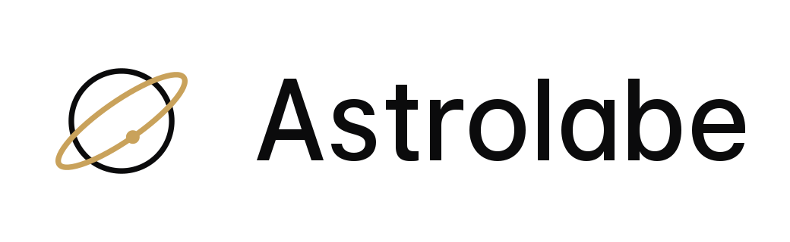

<p align="center">
  <picture>
    <source media="(prefers-color-scheme: dark)" srcset="assets/brand/lockup-on-dark.svg" />
    
  </picture>
</p>

<p align="center">English | <a href="README.fr.md">Français</a></p>

# Astrolabe

**See your notes as stars, folders as orbits, and links in motion.**

Astrolabe is a local desktop application built with Electron, TypeScript, and WebGL2 that
renders a folder of Markdown notes as an interactive 3D galaxy. Compatible with Obsidian
vaults, it parses wikilinks, tags, and frontmatter to map your knowledge base in real time.
Each note appears as a star, folders form concentric orbits, links render as fine lines with
traveling pulses of light, and a gravitationally lensed black hole sits at the core. Astrolabe
opens your directory in read-only mode and updates the scene automatically whenever files
change on disk. Everything runs locally on your machine with no network requests, no
accounts, and no external processing, leaving your files untouched while giving you a calm
spatial view of your writing.

Early stage, tested on Linux.

## Key features

- **Live 3D galaxy & folder orbits:** displays notes as stars arranged along folder orbits
  around a gravitationally lensed black hole, updating automatically as files change on disk.
- **Obsidian-compatible link rendering:** parses wikilinks, tags, and frontmatter, drawing
  connections as thin lines with traveling lights.
- **Search & keyboard shortcuts:** navigate your vault and locate specific notes quickly
  across the 3D view.
- **Activity sidebar:** review recent edits, file activity, and tasks from a dedicated panel.
- **Custom CSS themes & UI tuning:** install new themes by adding a theme folder with a
  manifest and CSS file. Use the settings panel to tune colors, motion speed, star glow, and
  interface blur within a minimal frosted-glass interface.

## Why Astrolabe

Flat file trees and dense two-dimensional node graphs can make large collections of Markdown
notes difficult to orient within at a glance. Astrolabe uses your existing directory
structure and link relationships to organize notes into a clear spatial hierarchy that
reflects how your vault is structured and connected. Because it operates as a read-only
viewer directly on top of your local folder, you can explore your writing visually without
changing your editor or moving your files into a proprietary format.

## Privacy

Astrolabe runs entirely on your local machine with no network requests, no accounts, no
telemetry, and no AI or cloud calls. Your folder is accessed strictly in read-only mode, so
your notes are never modified on disk or sent anywhere.

## Getting started

Requirements: [Node.js](https://nodejs.org/) 22.12 or later (with npm), and a graphics card
with WebGL2 for the galaxy scene (without it, Astrolabe falls back to a simpler 2D scene).

```bash
npm install      # once: installs the tools (Electron, Vite, TypeScript)
npm run dev      # starts the app in development mode
npm run build    # compiles the app into dist/
```

**Your notes:** put them in a `vault/` folder at the root of the project (`.md` files,
organized in subfolders if you like). This folder is **not** shipped with the repository and
is ignored by git: create your own, or copy an existing Obsidian vault into it. If it is
missing, the app simply says so.

Settings (active theme, colors, sliders) are stored in the app's data folder
(`~/.config/astrolabe` on Linux), never inside your vault.

## Shortcuts

The full list is built into the app: press `?` to open it.

- `H` opens Home and search · `,` opens the settings · `B` collapses the sidebar
- `?` shows all shortcuts (on an AZERTY keyboard: `Shift` + `,`; on QWERTY: `Shift` + `/`)

## Themes

A theme is a folder in `themes/` with a `manifest.json` and a CSS file that redefines a set
of `--sc-*` variables; it can also pick the scene that draws the graph. See
[`themes/README.md`](themes/README.md) to create your own.

## Acknowledgements and licenses

- The sky and black hole shaders, the lensing model and the star and link style of the galaxy
  scene are adapted from
  [second-brain-black-hole](https://github.com/williamwasen/second-brain-black-hole)
  (MIT, © williamwasen). See [`THIRD_PARTY_LICENSES.md`](THIRD_PARTY_LICENSES.md).
- Astrolabe is an independent project and is not affiliated with or endorsed by Obsidian.
- License: not chosen yet.
